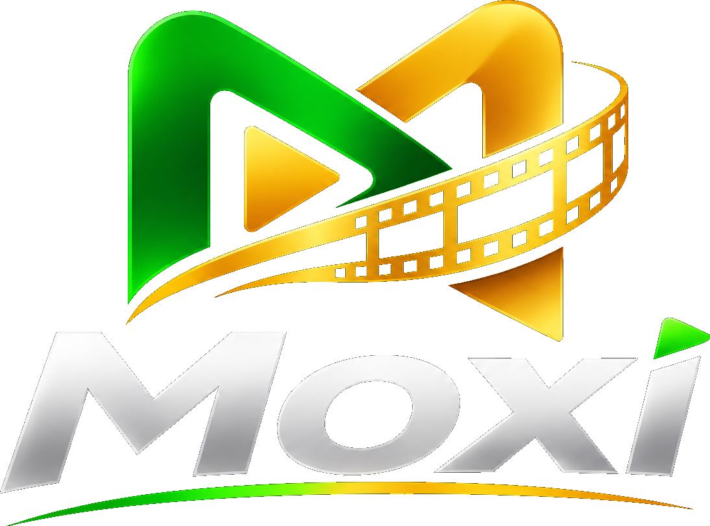

# 🎬 Moxi

<div align="center">



### Freedom to Stream — Next-Generation Cinematic Media Platform

[](https://github.com/ursir1/moxi/releases)
[](LICENSE)
[](https://github.com/ursir1/moxi/releases)
[](https://moxi-5n1.pages.dev/)
[](moxi-web)
[](moxi-shell)

[**🌐 Launch Web Player**](https://moxi-5n1.pages.dev/) &nbsp;|&nbsp; [**📥 Download Desktop App**](https://github.com/ursir1/moxi/releases) &nbsp;|&nbsp; [**📖 Architecture**](#-architecture) &nbsp;|&nbsp; [**🛠️ Developer Guide**](#-building-locally)

---

</div>

## 🌟 Overview

**Moxi** is an open-source, hardware-accelerated media streaming client and web application. Designed for cinematic viewing with an emerald-and-gold visual identity, Moxi combines a native desktop shell with a fast, modern web frontend to organize and stream movies, TV shows, anime, YouTube, and live feeds from community addons.

- **`moxi-shell`**: Native Windows container written in Rust. Integrates Microsoft Edge WebView2 for UI rendering alongside a dedicated 64-bit MPV core for hardware-accelerated 4K/HDR video decoding.
- **`moxi-web`**: Responsive single-page application built with React 18, TypeScript, and WebAssembly, deployed globally via Cloudflare Pages.

---

## ✨ Key Features

- ⚡ **Hardware-Accelerated Video Playback**: Dedicated MPV engine handles 4K, 8K, HDR, HEVC, AV1, VP9, and smooth SSA/ASS subtitle rendering with zero stutter.
- 🌐 **Available Everywhere**: Seamlessly switch between the native Windows desktop application and the global web client at [moxi-5n1.pages.dev](https://moxi-5n1.pages.dev/).
- 🧩 **Extensible Addon Ecosystem**: Full compatibility with the Stremio addon protocol. Connect catalog, metadata, streaming, and subtitle addons with one click.
- 🎨 **Cinematic Moxi Theme**: Custom dark emerald aesthetic with warm gold accents, tailored for home theater and desktop setups.
- 🔄 **Cloud & Local Synchronization**: Keep your library, watch progress, and addon configurations synchronized across sessions.
- 🤖 **Automated CI/CD Delivery**: GitHub Actions pipeline automatically builds, packages, and attaches signed Windows installers (`.exe`) on every release commit.

---

## 📥 Downloads & Installation

### Windows Desktop (Recommended)

Download the latest version from [GitHub Releases](https://github.com/ursir1/moxi/releases):

| Download Asset | Description |
| :--- | :--- |
| **`MoxiSetup-v*.exe`** | Official Windows installer with desktop shortcuts, file associations (`.torrent`, `moxi://`), and auto-updater |
| **`moxi.exe`** | Standalone portable executable |

### Web Client

You can run Moxi directly in any modern browser (Chrome, Edge, Firefox, Brave, Safari) without installing software:
👉 **[https://moxi-5n1.pages.dev/](https://moxi-5n1.pages.dev/)**

---

## 🏛 Architecture

```
MoxiApp/
├── .github/workflows/
│   └── release.yml          # Automated CI/CD (pnpm build -> cargo build -> Inno Setup -> Release)
├── moxi-shell/              # Native Windows Desktop Client (Rust)
│   ├── src/                 # Shell logic, WebView2 embedding, MPV player integration, IPC
│   ├── images/              # Multi-resolution ICOs, installer headers, splash screens
│   ├── setup/               # Inno Setup scripts (Stremio.iss / Moxi installer)
│   └── Cargo.toml           # Rust configuration and binary dependencies
├── moxi-web/                # Modern Web Frontend (React + TypeScript)
│   ├── assets/              # Icons, logos, fonts, symbols
│   ├── src/                 # React UI components, router, Less themes, addon manager
│   └── package.json         # Web dependencies and pnpm scripts
├── LICENSE                  # GNU General Public License v2.0
└── README.md                # Project documentation
```

### Component Roles

1. **`moxi-web` (Presentation Layer)**:
   - Manages state, routes, catalog discovery, search, addon management, and user library.
   - Communicates with local or remote streaming engines over secure WebSockets and HTTP IPC.
2. **`moxi-shell` (Native Runtime)**:
   - Houses the WebView2 browser control and binds native Windows window management (caption color, maximize/minimize, tray notifications).
   - Binds the MPV video decoding pipeline for native media streams.

---

## 🛠️ Building Locally

### Prerequisites

Ensure you have the following installed on your machine:
- [Node.js (v22+)](https://nodejs.org/) & [pnpm](https://pnpm.io/)
- [Rust & Cargo](https://rustup.rs/) (MSVC x86_64 target)
- [Inno Setup 6](https://jrsoftware.org/isdl.php) *(required only for building the installer)*

### 1. Build the Web Frontend

```powershell
# Navigate to web frontend
cd moxi-web

# Install dependencies
pnpm install

# Run local development server
pnpm start

# Or build for production
pnpm build
```

The production assets will be output to `moxi-web/build/`.

### 2. Build the Desktop Shell

```powershell
# Navigate to desktop shell
cd ../moxi-shell

# Run desktop app in debug mode
cargo run

# Build optimized release binary
cargo build --release --target x86_64-pc-windows-msvc
```

The compiled executable will be located at `moxi-shell/target/x86_64-pc-windows-msvc/release/moxi.exe`.

### 3. Package the Windows Installer

```powershell
# Navigate to setup directory
cd setup

# Generate MoxiSetup-v*.exe
.\create_setup.bat
```

---

## 🚀 Continuous Deployment

This repository uses automated GitHub Actions workflows:

- **Web Frontend**: Automatically compiled and deployed to Cloudflare Pages upon pushing to `main`.
- **Windows Desktop Releases**: Adding `[release]` to any commit message automatically triggers `.github/workflows/release.yml`. The runner builds the web assets, compiles the Rust shell with MPV, generates `MoxiSetup-*.exe`, and publishes a tagged release on GitHub.

---

## ⚖️ Open Source & Licensing

Moxi is free and open-source software distributed under the terms of the **[GNU General Public License v2.0 (GPL-2.0)](LICENSE)**.

### Upstream Attribution
- Moxi is based on the open-source codebase of **Stremio** (`stremio-web` and `stremio-shell-ng`), developed by [Smart Code OOD](https://www.stremio.com/).
- We express gratitude to the Stremio team and open-source contributors for establishing the foundation and addon protocol.
- Original code remains under Copyright (C) Smart Code OOD and respective contributors under GPL-2.0.
- Modifications, rebranding, and customized assets are Copyright (C) 2026 Moxi Contributors.

### What GPL-2.0 Means For Users and Developers
- **Freedom to Run & Inspect**: You are free to run, audit, study, and modify Moxi for personal or commercial purposes.
- **Copyleft Commitment**: Any derivative versions or modifications distributed to others must also remain open source under the GNU General Public License v2.0.
- **Brand Identity**: "Moxi" and its associated custom logos are distinct trademarks of the Moxi project, independent of Smart Code OOD and the Stremio trademark.
