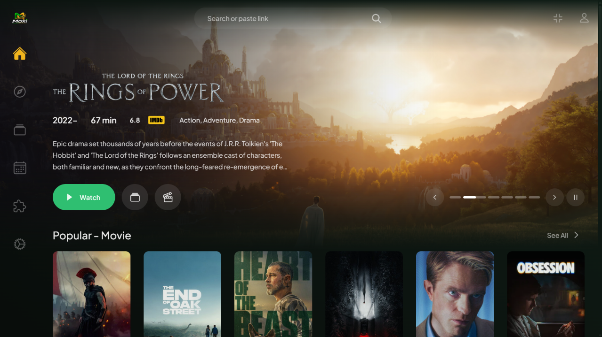
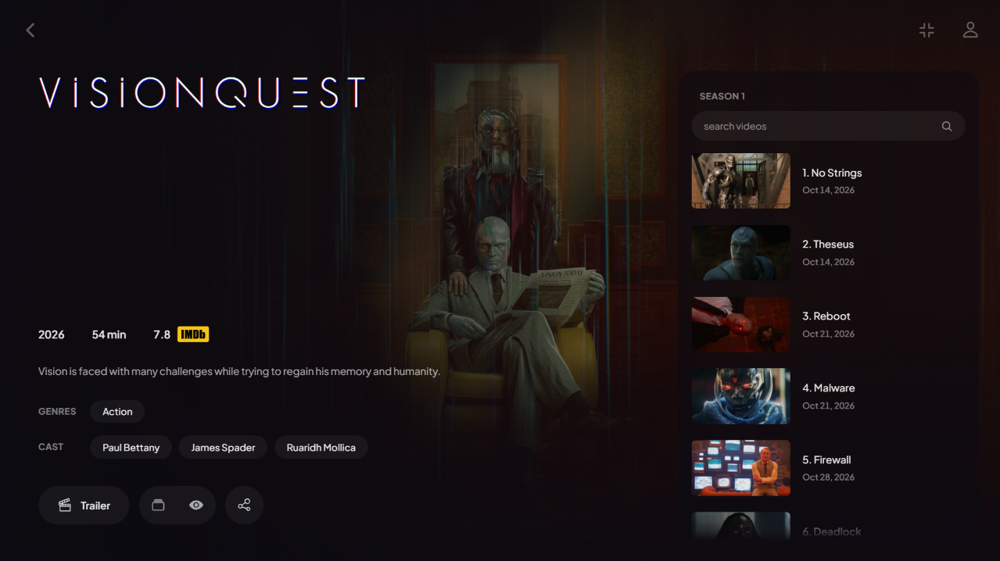
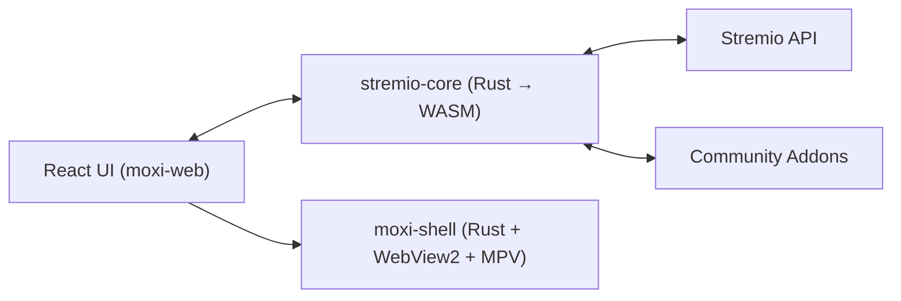

<div align="center">


# Moxi

**Freedom to Stream** — an open-source cinematic media platform for Windows desktop and self-hosted web, powered by the Stremio addon ecosystem.

[](https://github.com/ursir1/moxi/actions/workflows/release.yml)
[](https://github.com/ursir1/moxi/releases)
[](LICENSE)

[**📥 Download**](https://github.com/ursir1/moxi/releases) · [**Report a bug**](https://github.com/ursir1/moxi/issues/new)



</div>

---

## ✨ Features

- 🧩 **Addon-powered** — movies, series, anime and more from community addons
- 🔄 **Sync everywhere** — library and Continue Watching follow your account
- ⚡ **Hardware-accelerated** — 4K/HDR/HEVC/AV1 via dedicated MPV engine (desktop)
- 💬 **Subtitles** — SSA/ASS with full styling support
- 🎨 **Cinematic theme** — dark emerald and gold aesthetic
- 🌐 **Self-hostable** — deploy `moxi-web` on any static host (Cloudflare Pages, Vercel, Netlify…)
- 📱 **Installable** — runs as a standalone PWA on the web

---

## 📸 Screenshots

<div align="center">

| Home | Details |
|:---:|:---:|
|  |  |

</div>

---

## 🛠 How it works



`moxi-web` is a React single-page app. On desktop, it runs inside `moxi-shell` — a lightweight Rust wrapper that embeds Microsoft Edge WebView2 for the UI and a dedicated 64-bit MPV process for hardware-accelerated video. On the web, it connects to any compatible streaming server.

---

## 🚀 Getting started

```sh
cd moxi-web
pnpm install
pnpm start       # local dev server at http://127.0.0.1:11471
```

| Command | What it does |
|---|---|
| `pnpm start` | Dev server with hot reload |
| `pnpm build` | Production build → `moxi-web/build/` |
| `cargo run` (in `moxi-shell/`) | Run the desktop shell in debug mode |
| `cargo build --release` | Build the optimized desktop binary |

---

## 📥 Downloads

| Asset | Description |
|---|---|
| **`MoxiSetup-v*.exe`** | Windows installer — includes shortcuts, file associations (`.torrent`, `moxi://`), and auto-update |
| **`moxi.exe`** | Standalone portable binary |

Get the latest from [**GitHub Releases →**](https://github.com/ursir1/moxi/releases)

---

## 🤝 Contributing

Bug reports and pull requests are welcome. [`good first issue`](https://github.com/ursir1/moxi/labels/good%20first%20issue) is a great place to start. All contributions must remain open source under GPL-2.0.

---

## 🧩 Ecosystem

| Repository | What it is |
|---|---|
| [moxi-web](moxi-web/) | React UI: routes, components, Less themes |
| [moxi-shell](moxi-shell/) | Rust desktop shell: WebView2 + MPV + IPC |
| [stremio-core](https://github.com/Stremio/stremio-core) | Rust engine: state, addon protocol, library, sync |
| [stremio-addon-sdk](https://github.com/Stremio/stremio-addon-sdk) | Build your own addon |

---

## 📄 License

Copyright © 2026 Moxi Contributors. Based on [Stremio](https://github.com/Stremio/stremio-web) © Smart Code OOD. Released under GPL-2.0 — see [LICENSE](LICENSE).
